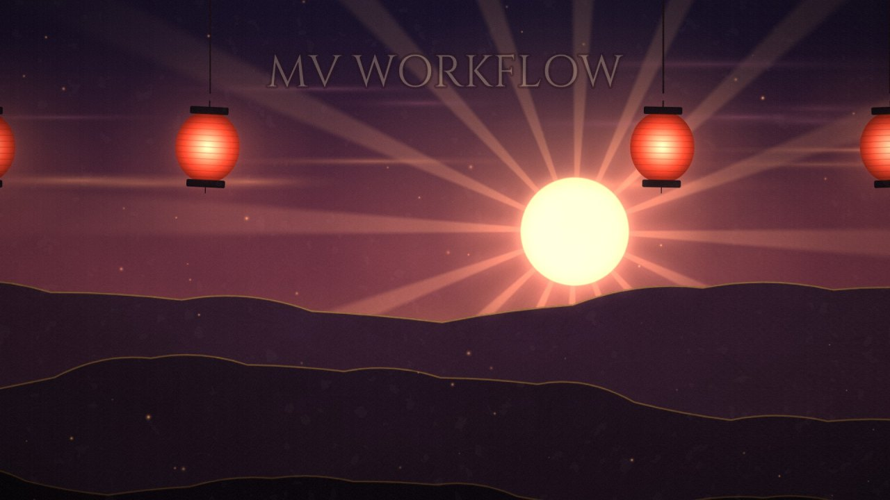

# mv-workflow

一个 [Claude Code](https://claude.com/claude-code) skill：用代码做音乐视频（MV / PV / 二创 MV）的整套工作流。

A Claude Code skill (written in Chinese) for making music videos with code: beat and per-syllable lyric timing, story and storyboard, character art and flat assets, 2.5D compositing with Blender plates, rendering, automated QA, partial re-renders, delivery and revision rounds.

它是从《神のまにまに》非官方二创 MV 的三十多版修改里整理出来的。

## 里面有什么

- **流程**（`SKILL.md`）：节拍分析和逐字歌词时间轴 → 故事和分镜 → 角色立绘和平面素材（生成、抠图、去 AI 味）→ 在 2.5D 合成引擎里搭镜头（配 Blender 三维底片）→ 分段渲染 → 自动自检 → 只重渲改动的片段再拼接 → 对比图交付 → 按意见迭代。
- **审美规则**（`references/style_rules.md`）：几十轮修改意见总结出来的"什么样的镜头不好看"，比如 PPT 感、贴在画面上的歌词、没有理由的转场。
- **参考资料**（`references/`）：合成引擎用法、素材生成和清理、Blender 底片、歌词卡点、自检和压制、封面和投稿简介。
- **工具脚本**（`scripts/`，Python + ffmpeg，可以单独用）：
  - `qa_scan.py`：全片扫描黑帧、单帧跳变和冻结；
  - `contact_sheet.py`：按时间间隔抽帧，拼成接触表；
  - `compare_sheet.py`：新旧两版同一时刻并排的对比图；
  - `assemble.py`：把重渲的片段按帧拼进底片，压出 1080p、720p 和手机版。
- **项目模板**（`assets/template/`）：可以直接用的 2.5D 合成引擎（moderngl）、多进程渲染器、音频分析、逐字歌词对齐、素材清理和自检工具，外加一个演示镜头。整个复制一份就是一个新的 MV 项目，用法见里面的 README。

模板里的演示镜头渲出来是这样（一个一直往前推的镜头中的一帧）：

## 安装

- **Claude Code**：把 `mv-workflow/` 文件夹复制到 `~/.claude/skills/`（Windows 是 `%USERPROFILE%\.claude\skills\`）。
- **Claude 应用**：在设置的 Skills 里上传 `mv-workflow.skill`。它其实是 zip 包，上传框只认 `.zip` 的话，把扩展名改成 `.zip` 再传。

装好以后，说"给这首歌做个 MV""这个镜头改一下""做个封面"之类的话，Claude 就会用上它。

## 需要的环境

- 工具脚本：Python 3（`opencv-python`、`numpy`、`Pillow`），`ffmpeg` 要在 PATH 里。
- 项目模板：依赖写在 `mv-workflow/assets/template/requirements.txt`（Python 3.12 上测过）；合成引擎需要支持 OpenGL 3.3 的显卡。
- 可选：Blender（渲三维底片），以及一个生图工具（gpt-image 或本地 ComfyUI）。

## 说明

- 模板里是通用的引擎和工具；《神のまにまに》MV 本身的镜头代码、素材、音频和歌词都不在这里。文档里偶尔提到的个别专用脚本（比如做封面、插图的）只在作者本地的项目里。
- 字体用的是 14 个 Google Fonts 免费字体（SIL OFL），仓库里不附带，由 `fonts/fetch_fonts.py` 从 Google Fonts 的 GitHub 仓库下载。

## 协议

[MIT](LICENSE)：可以自由使用、修改和再发布，保留版权声明就行。协议只覆盖这个仓库里的代码和文档：字体是下载来的，各自按 SIL OFL 协议；《神のまにまに》的原曲、歌词和角色都不在这个仓库里，也不在协议范围内。
